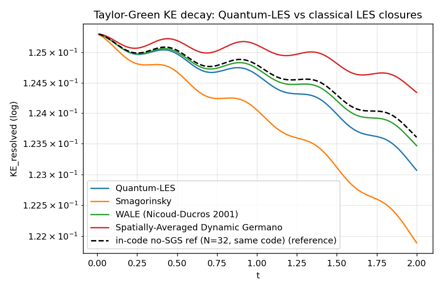
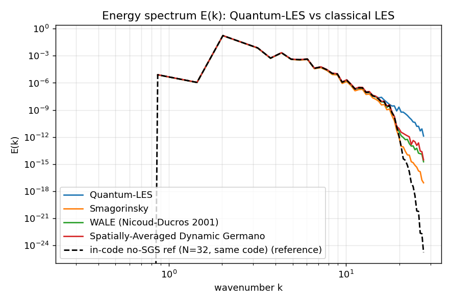
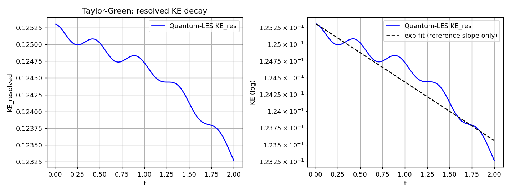
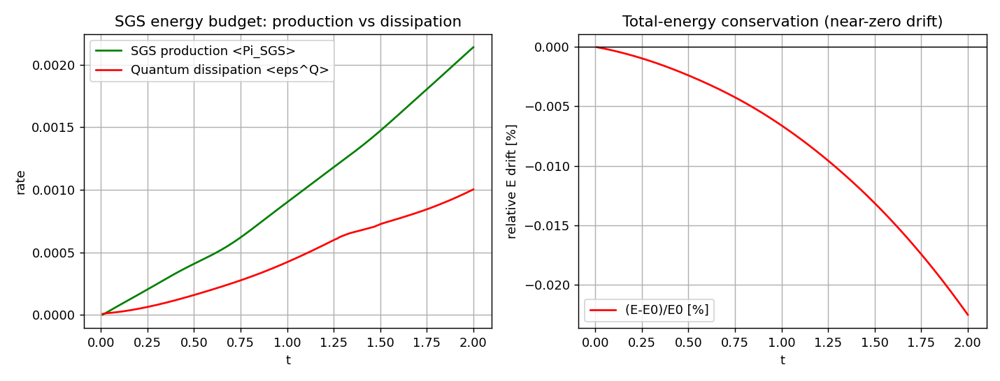
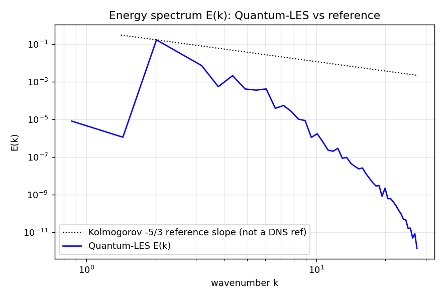
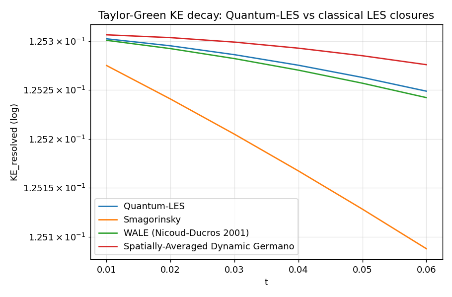
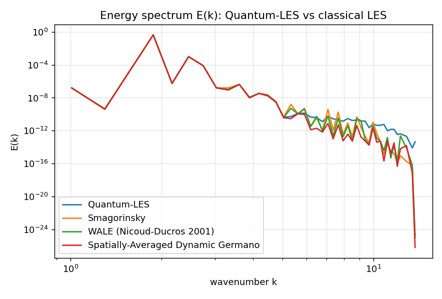

# Hybrid Quantum-Enhanced LES Closure Model (Q-LES)

*A quantum-enhanced LES closure model — the quantum computer as an unconventional SGS model, not the CFD engine*

**Main file:** `quantum_les_rev4.py` (single file, ~2310 lines; the filename is historical — the code is **Rev 12**, FIX 1–40)

A research platform: a **classical** LES solver (compressible Navier-Stokes + k_SGS transport) with an experimental **quantum-enhanced subgrid-scale (SGS) closure** — a per-block VQE (Variational Quantum Eigensolver) on a spectral-triad Hamiltonian. The same codebase doubles as an **LES benchmarking platform**: head-to-head comparison of the quantum closure against standard classical models (Smagorinsky, WALE, Spatially-Averaged Dynamic Germano) and against a no-SGS reference trajectory ("DNS-mode"), all on the common **Taylor-Green vortex** benchmark.

---

## 0. Why this project makes sense — and what its goal is

### Project positioning (naming matters)

In practice this project is **not** a "quantum Navier-Stokes solver". It is:

> **Hybrid Quantum-Enhanced LES Closure Model**

where the quantum computer plays the role of an **unconventional SGS subgrid model**, and **not** of the main CFD engine. The CFD engine (compressible NS + k_SGS, finite differences, RK4, periodic BCs) is fully classical and runs entirely on a classical computer; the quantum part is only the subgrid closure — a per-block VQE evaluating ⟨ψ|H_triad|ψ⟩ of a triad Hamiltonian, whose result scales the block-local SGS dissipation. **It is exactly this closure that is potentially publishable as science** — not "quantum CFD" as a whole.

### The project's question

This is a research project of the type:

> **"Can quantum variational models represent turbulent subgrid physics?"**

and **not**:

> "Can we beat WALE today?"

Those are two different questions.

| Engineering question | Scientific question |
|---|---|
| Which LES model do I use tomorrow in an aircraft simulation? | Can quantum state space represent turbulent triad couplings better than classical SGS models? |
| Answer: **WALE** (and it stays that way) | This is exactly what the project tries to answer |

### Why quantum mechanics? — as a computational tool, not as physics

This is **not** about:

> "small vortices are quantum"

it is about:

> "the space of possible couplings between modes is enormous"

and a quantum computer can potentially represent this well: **high-dimensional states, entangled degrees of freedom, large Hilbert spaces**. So the argument goes:

> **We use quantum mechanics as a computational tool for SGS modeling, not because SGS turbulence is a quantum phenomenon.**

That is a huge difference. For example — WALE does:

```text
u(x) → gradients → analytic formula → νt
```

while Quantum-LES does:

```text
u(x) → FFT → triads k,p,q → Hamiltonian → VQE → eps_sgs → νt
```

The QPU plays the role of a **very complex nonlinear approximator**: a parametrized quantum circuit (ansatz), optimized by VQE, evaluates the effective block dissipation from the full triad spectrum — without a closed analytic formula (which simply does not exist in SGS).

### What the benchmarks have shown so far — very honestly

**Achieved:**

- ✅ a working quantum-classical SGS built (per-block VQE on a triad Hamiltonian, CUDA-Q or CPU fallback),
- ✅ energy balances preserved (symmetric Π_SGS transfer, E drift ≈ −0.02% at t=2, transfer_error ~ machine epsilon),
- ✅ stability maintained (feedback clip [0.5, 2.0], dt cap ≤ 0.01, qubit hysteresis — no blow-ups in the runs so far: smoke tests + Re=1600 campaign; Re=5000/10000 runs are next in line, §12),
- ✅ results **comparable to WALE** (dlogKE/dt and E(k) in the same range; minimal RMSE vs WALE in the Re=1600 campaign),
- ✅ E(k) spectrum tests passed correctly (Parseval calibration: ∫E dk = KE, ratio 1.000000 / 1.00004 at Ma=0.35).

**Not yet demonstrated:**

- ❌ an advantage over WALE,
- ❌ an advantage over Dynamic Germano,
- ❌ an advantage over a DNS reference (in-code no-SGS; a true published DNS requires external data),
- ❌ the justification of a 50–200× higher cost (partial answer: FIX 38 — 99.3% of the cost is `observe()`, i.e. exactly the part that a GPU/QPU accelerates).

### Project goal (current formulation)
> **To demonstrate that a turbulent SGS model can be formulated as a quantum problem (triad Hamiltonian + VQE) and yield physically correct LES solutions.**

And **not**: to replace WALE in production CFD simulations.

Based on the benchmarks so far: **the first goal has been largely achieved, the second has not yet.** Further work is purely validation (Re=1600/5000/10000 campaign, Γ_kpq sensitivity, VQE cost) — see §12.

---

## 1. What this is, and the research claim

Honest classification (consistent with the in-code comments):

- **Classical part** — a fully-fledged, energetically consistent LES solver: compressible NS (6 equations for conservative variables) + one-equation k_SGS transport, finite differences with periodic BCs, RK4, adaptive CFL timestep.
- **Quantum part** — an *experimental SGS closure*: in each block the solver builds a local spectral-triad Hamiltonian (Jordan-Wigner mapping of the operators `a†_i a_j a_m + h.c.`), a VQE evaluates its expectation value, and the result scales the SGS dissipation in that block.
- **Γ_kpq is a heuristic geometric closure** (FIX 31) — it is *not* derived from the NS nonlinearity. Only the fermion→qubit mapping is exact (verified by a Fock-space self-test). Consequence: the quantitative accuracy of the model must be assessed by benchmarks (FIX 27–30, 37–39), not assumed from first principles.

The research question (post-Rev10): **"does Quantum-LES reproduce KE-decay and E(k) closer to a DNS reference than WALE / Dynamic Germano?"** — a validation question, not an architectural one.

---

## 2. Architecture

```
                ┌──────────────────────── CLASSICAL SOLVER (CompressibleLES3D) ───────────────────────┐
                │  U[0..5] = (rho, rho*u, rho*v, rho*w, E, rho*k_sgs), grid N^3, blocks nb^3 + halo    │
                │                                                                                      │
  step t ──────►│  1) S_ij, Omega_ij (global, finite differences)                                      │
                │  2) per block: Pi_SGS = -L_ij S_ij (Leonard stress, block FFT with halo)              │
                │  3) CLOSURE (dispatch on self.closure):                                               │
                │     ├─ "quantum"      → update_quantum_sgs_physics()   [quantum path, below]          │
                │     ├─ "smagorinsky"  → nu_t = (Cs*Delta)^2 |S|        Cs=0.18                        │
                │     ├─ "wale"         → Nicoud-Ducros 2001, Eq. 25   c_w=1.35, beta=0.6               │
                │     ├─ "dyn_germano"  → nu = -<B L>/<L L>, box-averaged, clip [-0.5 nu_smag, 3 nu_smag]│
                │     └─ "dns"          → nu_t = Pi_SGS = eps^Q = 0 (no-SGS reference of the same code)  │
                │  4) RK4: rhs() with symmetric transfer  rhs[4] -= Pi_SGS,  rhs[5] += Pi_SGS            │
                └───────────────────────────────────────────────────────────────────────────────────────┘

  QUANTUM PATH (per block, per step):
     block FFT (nb^3) ─► k-modes with modal energy
        │
        ├─ count_subgrid_candidates()          → subgrid candidate-shell richness
        ├─ dynamic qubit count: n_q = clip(cand // qubit_mode_ratio, nq_min, nq_max)
        │    + HYSTERESIS (q_hysteresis=3 consecutive steps before committing)   [FIX 22/35]
        ├─ find_spectral_triads_from_fft()     → resonant triads k+p+q=0, O(N^2) dict lookup [FIX 6]
        ├─ build_jw_triad_hamiltonian()        → H_SGS = Σ_k ω_k n_k + Σ_{k,p,q} Γ_kpq (a†_i a_j a_m + h.c.)
        │    exact JW mapping (PauliSum) [+ to_cudaq() when CUDA-Q is available]
        ├─ VQE: COBYLA on cudaq.observe (GPU)  OR  bound-constrained local search (CPU, n_q ≤ 8)
        └─ q_e = <H>  →  q_scale = clip(|q_e|/S_ref, 0.4, 2.5)  →  eps_SGS(x) in the block
             FEEDBACK: eps_{n-1} → H_n (diagonal ω_k + Γ_kpq), clipped to [0.5, 2.0]   [FIX 19/26]
```

### 2.1 Governing equations (conservative state U = [ρ, ρu_x, ρu_y, ρu_z, E, ρk_sgs])

| # | Equation | Notes |
|---|----------|-------|
| 0 | ∂ρ/∂t + ∇·(ρu) = 0 | |
| 1–3 | ∂(ρu_i)/∂t + ∇·(ρu_i u + p δ_ij) = ∇·(ν_eff ∇u) | ν_eff = max(0.05 ν_mol, ν_mol + ν_t); p = max(0.05, (γ−1)(E − ½ρ\|u\|²)), γ=1.4 |
| 4 | ∂E/∂t + ∇·((E+p)u) = viscous work **− Π_SGS** | FIX 2: the resolved side loses exactly what the SGS side gains |
| 5 | ∂(ρk_sgs)/∂t + ∇·(ρk_sgs u) = **Π_SGS** − ε^Q ρ k^1.5/Δ + diffusion | FIX 1: production = the FULL (signed) Leonard stress → backscatter retained; ε^Q is the closure (quantum or classical) |

Transfer symmetry is *measured*, not assumed: `transfer_error = |∫(−Π_SGS) + ∫(+Π_SGS)|` computed from the actual RHS integrals (FIX 18) — expected at machine-epsilon level.

### 2.2 Triad Hamiltonian (reduced NS model, exact JW mapping)

```
H_SGS = Σ_k ω_k n_k  +  Σ_{k+p+q=0} Γ_kpq (a†_i a_j a_m + h.c.)

ω_k  = turnover(k) + ν_mol k²  +  min(c·ε_{n-1}, turnover)          [diagonal, FIX 19/26]
Γ_kpq = geom · cbrt(tri_weight) · (1 + 0.2 S_mag) / Δ^(4/3) · feedback_scale · gamma_scale
geom  = |k × p| / (|k||p|)                                          [helical factor; collinear triads vanish]
```

- `tri_weight` — product of the modal energies of the modes in the triad (FIX 9).
- `feedback_scale = clip(1 + c·ε_{n-1}, 0.5, 2.0)` — two-way closure loop H_n ← ε_{n−1} (FIX 19/26).
- `gamma_scale` — multiplier for sensitivity studies (FIX 39; 1.0 = Rev11 behaviour).
- **Honesty (FIX 31):** the prefactor `(1 + 0.2 S_mag)` and the exponent Δ^(−4/3) are *model choices*, not coefficients derived from NS — which is why the Γ sensitivity campaign is part of the validation protocol, not an option.

### 2.3 Dynamic qubit count

`n_q = clip(cand // qubit_mode_ratio, nq_min, nq_max)` (defaults: ratio=2, [6,12]; CPU cap 8 — FIX 8).
**Explicit heuristic (FIX 35):** the "1 qubit per 2 candidate modes" relation has no physical derivation — the parameters are named, documented knobs (`qubit_mode_ratio`, `nq_min`, `nq_max`), not magic numbers. Hysteresis (FIX 22) prevents n_q from oscillating step-to-step. When n_q changes, only the **variational parameters** are carried over (`old_thetas[:keep]`) — this is *parameter transfer*, NOT optimizer continuation (the COBYLA/simplex state is re-initialized; FIX 36).

---

## 3. Code layout (`quantum_les_rev4.py`)

| Section | Contents |
|---------|----------|
| L1–118 | Docstring: project positioning, governing equations + full FIX 1–40 history (changelog) |
| `PauliSum` | Pauli-sum algebra: `+`, `-`, `scale`, `mul`, `simplify`, `matrix(n)`, `expectation(state)`, `to_cudaq()` |
| `jw_a / jw_adag / _fock_a` | Exact Jordan-Wigner images of creation/annihilation operators; `run_jw_self_test()` — Fock-space algebra verification (`--selftest`) |
| `cpu_ansatz_state` | CPU state-vector ansatz (H → RY/RZ → CX+RZ layers), 2^n amplitudes |
| `count_subgrid_candidates` | Subgrid candidate-shell richness from the block FFT |
| `find_spectral_triads_from_fft` | Resonant triads k+p+q=0, O(N²) via a `mode_lookup[k_vec]` dictionary (FIX 6) |
| `build_jw_triad_hamiltonian` | H_SGS: diagonal ω_k + Γ_kpq couplings (JW), feedback, `gamma_scale` |
| `vqe_triad_ansatz` (cudaq.kernel) | GPU ansatz: H; RY(θ_i c_i); RZ; CX–RZ–CX layers |
| `VQETriadTrainer` | COBYLA (CUDA-Q) / local search (CPU); `cost_function` = observe(); `cost_acc` hook for FIX 38 |
| `CompressibleLES3D` | Solver: Taylor-Green init, CFL, RHS, RK4 (`step()`), energy budget, E(k) spectrum, classical closures, quantum path, benchmark harnesses |
| `__main__` | CLI (argparse) + campaign dispatch |

Key methods of `CompressibleLES3D`:

- `init_flow_field()` — Taylor-Green: u = (sin x cos y cos z, −cos x sin y cos z, 0.05 sin 2z sin(x+y)), ρ_0=1, p_0 = ρ_0/(γM²), Mach set by argument; k_sgs(0)=1e-4.
- `compute_cfl_timestep()` — min(CFL·Δx/(\|u\|+c_max), 0.25Δx²/ν_max, **0.01**) — hard cap dt ≤ 0.01.
- `compute_energy_budget()` — KE_resolved, KE_sgs, KE_tot, E_tot + drifts; `<Π_SGS>`, `<ε^Q>`, clipped ratio and Π−ε (FIX 17); transfer-closure error from the RHS integrals (FIX 18).
- `update_quantum_sgs_physics()` — per-block quantum path (FFT → triads → H → VQE → ε^Q), with FIX 38 cost instrumentation.
- `_update_classical_sgs()` / `_wale_nu_t()` / `_dyn_germano_nu_t()` — classical closures; the same Leonard stress as the quantum path (consistent diagnostic).
- `compute_energy_spectrum()` — isotropic E(k) **Parseval-calibrated** (FIX 24/30/33): û = fftn(u)/M ⇒ ∫E dk = ⟨½\|u\|²⟩ exactly; TWO ratios are reported: velocity-field (~1 by identity) and compressible KE (~1 only if ρ≈const, Ma=0.35).
- `run_validation()` / `_plot_validation()` / `plot_energy_spectrum()` — validation harness + figures.
- `compare_to_reference()` — max/mean error and decay-rate ratio against a reference curve (reference interpolated onto the model's time grid; FIX 20 naming).
- `_spectral_error()` — linear/log RMSE + relative L2 of spectra.
- `run_benchmark_comparison()` — head-to-head (FIX 27/28/29/37/38): KE(t) and E(k) for all models, s/step cost, RMSE vs reference, VQE breakdown.
- `run_scaling_benchmark()` — **decomposition-overhead** study (FIX 32/34): fixed N or fixed cells/block, #blocks = 1/8/64; this is NOT an HPC speedup (no MPI/threads/GPU) — labeled as such.
- `run_gamma_sweep()` — Γ_kpq sensitivity campaign (FIX 39).

---

## 4. Installation and requirements

| Dependency | Role | Required? |
|-----------|------|-----------|
| Python ≥ 3.10 | runtime | yes |
| `numpy` | solver, FFT, state-vector | yes |
| `matplotlib` | PNG figures (validation/benchmark) | recommended (without it: CSVs only) |
| `nvidia-cuda-q` (+ CUDA GPU) | real VQE on a QPU (`cudaq.observe`, COBYLA) | **optional** — without it, automatic CPU fallback (state-vector, n_q ≤ 8, local search); the code logs `[WARN] ... Enabling CPU emulation mode.` |

```bash
pip install numpy matplotlib
# optionally (GPU):
pip install nvidia-cuda-q   # requires a CUDA environment; target: --target nvidia
```

Verify the JW mapping before the first run:

```bash
python quantum_les_rev4.py --selftest     # Fock-space algebra: a†a, [a,a†]=1 on small n
```

---

## 5. CLI — full reference

| Option | Default | Description |
|--------|---------|-------------|
| `--grid N` | 32 | Grid size N³ (domain 2π)³, periodic BCs |
| `--reynolds R` | 2000.0 | Re = u L / ν_mol |
| `--mach M` | 0.35 | Mach number in the initialization |
| `--closure C` | quantum | `quantum` \| `smagorinsky` \| `wale` \| `dyn_germano` \| `dns` (FIX 37: no-SGS reference) |
| `--gamma-scale G` | 1.0 | Multiplier on the heuristic Γ_kpq (FIX 39; 1.0 = Rev11) |
| `--vqe-evals K` | 15 | Max VQE optimizer evaluations per block/step |
| `--block-size B` | 16 | Block edge nb³ (grid 32 → 8 blocks) |
| `--halo H` | 2 | Ghost-cell halo width for cross-block spectral ops (FIX 11) |
| `--steps S` | 20 | Steps for plain runs / `--validate` |
| `--out F` | qles_ke_decay.csv | CSV path for `--validate` |
| `--benchmark` | — | Head-to-head: Quantum vs Smagorinsky vs WALE vs Spatially-Averaged Dynamic Germano |
| `--bench-steps S` | 120 | Steps in the benchmark |
| `--bench-out P` | qles_benchmark | Output prefix for the benchmark |
| `--dns-ref` | — | In the benchmark: also run an in-code no-SGS reference on the same grid/Re/steps; every model scored vs it (FIX 37) |
| `--gamma-sweep "a,b,c"` | — | Γ_kpq sensitivity campaign, e.g. `"0.5,1.0,2.0"` (FIX 39) |
| `--sweep-steps S` | 150 | Steps per gamma_scale value |
| `--scale` | — | Decomposition-overhead study: N and #blocks (FIX 32/34) |
| `--scale-closure C` | smagorinsky | Closure for `--scale` (`quantum` is ~60× slower) |
| `--target T` | nvidia | CUDA-Q backend (without the package: CPU fallback) |
| `--selftest` | — | JW algebra self-test and exit |

### Examples

```bash
# 1) Quick smoke test (grid 16, 6 steps — tens of seconds)
python quantum_les_rev4.py --grid 16 --block-size 8 --benchmark --bench-steps 6 --vqe-evals 5

# 2) Validation: KE(t), SGS budget, E(k) + figures (Quantum-LES, Re=2000)
python quantum_les_rev4.py --grid 32 --reynolds 2000 --validate --steps 200 --out qles_ke_decay.csv

# 3) Re = 1600/5000/10000 campaign with no-SGS reference and VQE cost breakdown
for RE in 1600 5000 10000; do
  python quantum_les_rev4.py --grid 32 --reynolds $RE \
    --benchmark --bench-steps 200 --vqe-evals 15 --dns-ref --bench-out qles_re${RE}
done

# 4) Sensitivity to the heuristic Γ_kpq prefactor
python quantum_les_rev4.py --grid 32 --reynolds 5000 --gamma-sweep "0.5,1.0,2.0" --sweep-steps 150

# 5) Decomposition overhead (a study, NOT an HPC speedup)
python quantum_les_rev4.py --scale --scale-closure smagorinsky

# 6) Plain run with another closure / the no-SGS reference
python quantum_les_rev4.py --grid 32 --reynolds 1600 --closure dns --steps 200 --validate --out ref_dns.csv
```

### Using it as a module (Python API)

```python
import quantum_les_rev4 as qles

sim = qles.CompressibleLES3D(nx=32, reynolds=1600.0, mach=0.35,
                             vqe_max_evals=15, block_size=16, halo=2,
                             closure="quantum", gamma_scale=1.0)   # closure: ... | "dns"
for _ in range(100):
    dt, nu_t, q_e, *_ = sim.step()
bud = sim.compute_energy_budget()          # KE_resolved, drifts, <Pi_SGS>, <eps^Q>, transfer_error
k, Ek, n_shell = sim.compute_energy_spectrum()   # Parseval-calibrated E(k)
sim.run_benchmark_comparison(steps=200, run_dns_ref=True, out_prefix="qles_re1600")
sim.run_gamma_sweep(scales=(0.5, 1.0, 2.0), steps=150)
```

---

## 6. Campaign outputs

| Mode | Files |
|------|-------|
| `--validate` | `{out}.csv` (step, t, KE_resolved, KE_sgs, KE_tot, E_tot, log10KE, drifts, `<Π>`, `<ε^Q>`); `{pref}_ke_decay.png`; `{pref}_sgs_budget.png`; `{pref}_spectrum.png` + `{pref}_spectrum.csv` (k, E_k, n_shell) |
| `--benchmark` | `{bench-out}_{model}.csv` per model; `{bench-out}_ke_decay_compare.png` (with the reference curve when `--dns-ref`); `{bench-out}_spectrum_compare.png`; `{bench-out}_vqe_cost.csv` (FIX 38: component, s/step, % of closure) |
| `--gamma-sweep` | `qles_gamma.csv` (gamma_scale, step, t, KE, E); `qles_gamma_summary.csv` (gamma_scale, dlogKE/dt, mean ε_q, t_end); `qles_gamma.png` (decay per scale + decay-rate bars) |
| `--scale` | `qles_scaling.csv` (scaling/N/#blocks/block_size/cells/s_per_step/metric) |

Tables printed to stdout: per-model SUMMARY (`dlogKE/dt`, s/step, steps/s), **KE-decay rate vs reference** (delta_vs_ref), **SPECTRAL ERROR E(k)** (RMSE_lin / RMSE_log10 / rel_L2 — per model vs Quantum-LES and vs the reference), **FIX38 VQE COST BREAKDOWN**, **FIX33 SPECTRUM CALIBRATION** (both ratios).

### 6.1 Generated sample figures

The figures below were produced by the current code in this repository and are fully reproducible with the commands in §5.

#### Re=1600 campaign (`--benchmark --bench-steps 200 --dns-ref`, grid 32, t∈[0,2])


*KE(t) decay: Smagorinsky decays fastest (over-dissipative, ~6× DynGermano), Quantum-LES ≈ WALE, Spatially-Averaged Dynamic Germano slowest; black dashed = in-code no-SGS reference (N=32, same code) — it sits between DynGermano and WALE. Honest note: coarse-grid reference, not published DNS (FIX 37).*


*Energy spectrum E(k): all five curves overlap up to k≈15 (inertial range); they separate only in the dissipation range, where quantum keeps the highest tail and the reference shows a sharp grid-scale cutoff. Absolute calibration: FIX33 (∫E dk = KE, ratio ~1.0).*

#### Validation harness (`--validate`, Quantum-LES, Re=2000)


*KE decay: linear + log scale with an exponential fit — labeled "reference slope only" per FIX 25 (a fit to the model's OWN decay, not a DNS benchmark).*


*Left: Leonard production ⟨Π_SGS⟩ vs quantum dissipation ⟨ε^Q⟩ (both grow with t; Π > ε → part of the production feeds k_SGS). Right: total-energy drift (E−E0)/E0 ≈ −0.02% at t=2 — near-conservation, the first check any CFD reviewer performs (FIX 5/14).*


*Quantum-LES E(k) with the Kolmogorov −5/3 slope anchor (dotted; labeled "not a DNS ref" per FIX 25). Parseval-calibrated spectrum (FIX 30/33): ∫E dk = KE exactly.*

#### Smoke test (grid 16, 6 steps — wiring proof only, NOT for publication)


*Head-to-head on grid 16 / 6 steps — verifies that all four models are wired up; the physical values from this run are not meaningful.*


*Spectrum from the smoke test (grid 16, 6 steps) — wiring proof for FIX 27/30 only.*

---

## 7. Validation metrics and how to read them

| Metric | What it measures | Where |
|--------|------------------|-------|
| `d(log10 KE)/dt` (+ delta vs ref) | Decay rate — the main resolution-independent metric; answers "does the model beat WALE/DynGermano?" | SUMMARY, vs-ref table (FIX 37) |
| RMSE_lin / RMSE_log10 / **RMSE_log10(>−3dec)** / rel_L2 of E(k) | Absolute and logarithmic spectral error per model (vs Quantum-LES and vs reference); the floored column (FIX 40) is the one to quote — the raw log RMSE is pathological on near-zero dissipation-range bins | FIX 29/37/40 |
| KE/E drift [%] | Energy conservation: `(X−X0)/X0` per step — the first check any CFD reviewer performs | FIX 5/14 |
| `transfer_error = |∫rhs[4]_Π + ∫rhs[5]_Π|` | Closure of the symmetric resolved↔SGS transfer (~machine epsilon) | FIX 18 |
| `<Π_SGS>`, `<ε^Q>`, Π/ε (clipped), Π−ε | SGS budget: Leonard production vs closure dissipation | FIX 17 |
| Parseval ratios (velocity ~1; compressible KE) | Absolute calibration of E(k): ∫E dk = ⟨½\|u\|²⟩ by identity; equals compressible KE only when ρ≈const | FIX 30/33 |
| VQE cost breakdown (FFT / triad search / H build / observe / opt overhead) | Where the quantum time goes — decides the HPC narrative (a GPU accelerates `observe`, not the overhead) | FIX 38 |

**Different models will show DIFFERENT decay rates — that is the expected outcome of a comparison**, not a bug; only KE(t)+E(k) against the reference decide whether the quantum closure adds anything physical beyond classical LES.

---

## 8. Computational cost (measured, CPU, N=32, 8 blocks of 16³)

| Path | s/step | Notes |
|------|--------|-------|
| Quantum-LES (CPU VQE, vqe-evals=15) | **~1.8** | dominated by the per-block VQE; exact split from FIX 38 (`*_vqe_cost.csv`) |
| Classical closures / DNS-mode | ~0.03 | FFT + finite differences only |

Scaling (FIX 32/34, decomposition-overhead study — **not** an HPC speedup, no MPI/threads/GPU): weak scaling 32³→64³ with fixed blocks: efficiency ~0.81; strong (N=64³, #blocks 1/8/64): cost_ratio ≈ 0.95–0.97 → decomposition overhead is small, but more blocks per processor increase the per-step cost (one VQE per block).

---

## 9. Honest model limitations (to state explicitly in any paper)

1. **Γ_kpq — heuristic closure** (FIX 31): correct qualitative NS structure (helical factor, cbrt(tri_weight) amplitude scaling, dimensional Δ^(−4/3) prefactor), but the prefactors and exponents are model choices. The `--gamma-sweep` sensitivity campaign is therefore mandatory, not optional.
2. **n_q = cand // 2 — heuristic** (FIX 35): no physical derivation of "1 qubit per 2 candidate modes"; exposed as a documented knob.
3. **The "DNS reference" is an in-code no-SGS run of the same code** (FIX 37): at N=32 it is under-resolved for Re ≥ 5000 — a coarse-grid reference, NOT a published DNS dataset. Comparing against true DNS (e.g. Johnsson et al. 2018) requires external data via `ref_k/ref_ek/ref_t/ref_ke` in `run_benchmark_comparison`.
4. **CPU VQE = emulation**: state-vector (2^n amplitudes, n≤8) + local search instead of COBYLA/cudaq.observe; VQE cost numbers do not transfer 1:1 to a QPU.
5. **Parameter transfer ≠ optimizer continuation** (FIX 36): when n_q changes only θ is carried over; the optimizer state is re-initialized. In the paper: "parameter transfer".
6. **Dynamic Germano = box-averaged variant** (one coefficient per domain, L at Δ, B at 2Δ) — NOT the local C_s(x) form; labeled "Spatially-Averaged Dynamic Germano" in all logs/figures.
7. **Parseval-consistent for the velocity field**, not for compressible KE density (FIX 33): ∫E dk = ⟨½\|u\|²⟩ exactly; equality with the ρ-weighted KE requires ρ≈const (Ma=0.35 → small error, but mathematically distinct).
8. **Scaling study ≠ HPC speedup** (FIX 34): single-process CPU code; the reported cost_ratio is a decomposition overhead.

---

## 10. Reproducibility

- The Taylor-Green initialization and the entire classical dynamics are deterministic.
- VQE variational parameters are initialized with `np.random.uniform` **without a seed** → quantum runs carry small run-to-run variability (local search). For publication: set `numpy.random.seed(...)` before launching a campaign (a `--seed` option was deliberately not added — prototype behaviour).
- All metrics land in CSVs; the PNG figures (matplotlib, Agg) are deterministic for identical data.
- The JW self-test (`--selftest`) verifies the mapping in every new environment.

---

## 11. Changelog (Rev4 → Rev12, FIX 1–40)

**Rev4 (FIX 1–10)** — physical core: k_SGS production = full Π_SGS (backscatter retained); symmetric rhs[4]/rhs[5] transfer; energy-budget consistency without double counting; "exact JW mapping of the triads" nomenclature (H reduced); energy budget + drift; O(N²) triad discovery; dynamic qubits from candidate-shell richness; CPU cap n_q≤8; tri_weight in Γ_kpq; block-local Leonard stress.

**Rev5–6 (FIX 11–20)** — ghost-cell halo (cross-block triads); VQE parameter transfer on n_q change; Hamiltonian statistics in the logs; total-energy budget E_tot; Taylor-Green validation harness (`--validate`, KE(t), dlogKE/dt); core-mode spectral analysis (halo = auxiliary filter zone); SGS budget Π vs ε^Q; transfer closure from the RHS integrals; feedback-coupled closure ε_{n−1}→H_n; unambiguous ref_on_q naming.

**Rev7–8 (FIX 21–27)** — validation figures; qubit-count hysteresis; E(k) + Kolmogorov −5/3 anchor (as a *reference slope*, not DNS); isotropic E(k) with bin-width normalization; honest "not a DNS benchmark" labels; feedback clip [0.5,2.0] and ω_k cap; **classical closures (Smag/WALE/DynGermano) wired into step() + `--benchmark` head-to-head**.

**Rev9–10 (FIX 28–34)** — per-model s/step cost; RMSE/L2 of E(k); Parseval calibration of E(k) (fftn/M → ∫E dk = KE); honest note on the heuristic Γ_kpq; strong/weak scaling of per-step cost; split of velocity-field vs compressible-KE calibration; "strong scaling" relabeled as a decomposition-overhead study.

**Rev11 (FIX 35–36)** — dynamic qubit count as a documented heuristic knob (ratio/min/max); wording corrected: "parameter transfer", not "optimizer continuation".

**Rev12 (FIX 37–40) — validation-campaign tooling:**
- **FIX 37** — in-code no-SGS reference ("DNS-mode"): `--closure dns` and `--benchmark --dns-ref`; every model scored against the reference (decay rate + E(k)); honest labeling: coarse-grid reference, not published DNS.
- **FIX 38** — per-step VQE cost breakdown: FFT / triad search / Hamiltonian build / observe() / optimizer overhead → table + `{bench-out}_vqe_cost.csv`.
- **FIX 39** — Γ_kpq sensitivity: `--gamma-scale` knob (1.0 = Rev11) + `--gamma-sweep "0.5,1.0,2.0"` harness → KE(t), dlogKE/dt, mean ε^Q per scale, CSVs + figures.
- **FIX 40** — log metric pathology fixed: the raw RMSE_log10 of E(k) is dominated by near-zero tail bins (in the dissipation range a tiny linear difference spans several decades → RMSE_log ~ 2+ while rel_L2 ~ 1e-3). Added `RMSE_log10(>−3dec)` — log-RMSE restricted to bins above a 1e-3·max(E_ref) floor; this is the number to quote in the paper.

---

## 12. Project status and next steps

The architecture is considered publication-ready (no open mathematical inconsistencies in the code). Remaining work is **purely validation**:

1. Re = 1600/5000/10000 campaign runs (§5, item 3) — KE(t), E(k) vs reference, RMSE per model.
2. Γ sensitivity (§5, item 4) — the answer to "the prefactor is not NS-derived".
3. VQE cost breakdown (FIX 38) — the HPC-narrative decision: is the bottleneck `observe()` (→ GPU) or the overhead?
4. Optionally: an external published DNS Taylor-Green as ref_k/ref_ek (N>32), and true MPI/GPU strong scaling — both flagged as out of scope for the current prototype.

### Publication framing (target formulation, consistent with the §0 positioning)

Working title:

> **"A Hybrid Quantum-Enhanced LES Closure Model: VQE Evaluation of a Triadic Subgrid Hamiltonian on the Taylor-Green Vortex"**

Key sentences for the abstract/discussion (grounded in the benchmarks, no overclaiming):

- *The CFD engine is fully classical; the quantum computer acts as an unconventional SGS subgrid model — the contribution is the closure, not a quantum NS solver.*
- *Energetically consistent by construction: symmetric Π_SGS transfer (transfer_error ~ machine epsilon), Parseval-calibrated E(k) (∫E dk = KE).*
- *The quantum closure reproduces decay rates comparable to WALE on Taylor-Green; no advantage over the best classical closures has been demonstrated yet — an honest negative result that defines the validation campaign.*
- *99.3% of the quantum cost is in observe() → a QPU/GPU offload targets essentially all of the quantum cost (CPU-prototype measurement).*
